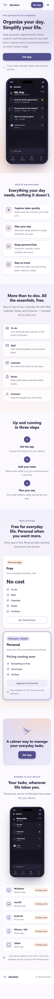

<p align="center"></p>

# Alondra1 landing page

[](https://github.com/nikita4sea/alondra1-www/actions/workflows/ci.yml)

The one-page marketing site for **alondra1.com**: a personal to-do app first, with Mail, Calendar, Notes, and Contacts included free, and a paid Personal plan that adds cloud sync and archive. It is a static site built by a small standard-library Python script and served by unprivileged nginx in its own container, deployed by [shared-landing](https://github.com/muove4sea/shared-landing) (Traefik + Docker Compose on the Hetzner host) as the `alondra1-landing` service.

| Mobile (375 px) | Desktop (1440 px) |
| --- | --- |
|  |  |

Tablet: [docs/screenshots/landing-768.png](docs/screenshots/landing-768.png).

## Local development

You need Python 3.11 or newer. There are no packages to install.

```sh
python build.py                                   # -> dist/
python -m unittest discover -s tests -t .         # content rules and built-page checks
python -m http.server 8000 --directory dist       # http://localhost:8000
```

Edit `src/` (page, styles, script), `config/site.json` (plans, platforms, links), or `public/` (images, favicons), then rebuild.

### With Docker (production-like)

```sh
docker build -t alondra1-landing:local .
docker run --rm -p 127.0.0.1:8080:8080 alondra1-landing:local
curl http://127.0.0.1:8080/healthz                # ok
```

The image build runs the tests first, so a page that breaks a content rule never becomes an image.

## Layout

| Path | Contents |
| --- | --- |
| `config/site.json` | The single data source: plans `{id, name, priceLabel, periodLabel, description, features[], ctaLabel, ctaUrl, featured, enabled}`, platforms `{id, label, status, downloadUrl?, subtitle?}`, and links. |
| `src/index.html` | Page template with the copy, in the spec's section order. `{{NAME}}` placeholders are filled by `build.py`. |
| `src/styles.css`, `src/main.js`, `src/consent.js` | Design tokens and layout (including the cookie banner); mobile menu (focus, Escape, click outside), header state, footer year; cookie consent and Consent Mode v2 (only included when `GTM_ID` is set). Fingerprinted into `/assets/` at build time. |
| `src/404.html` | Not-found page. |
| `public/` | Logo sizes, favicon, Open Graph image, and the Windows To-do screenshot for the device showcase. Copied as-is. |
| `build.py` | Validates the config, renders the page, writes `robots.txt`, `sitemap.xml`, and `404.html`. |
| `tests/` | `unittest` suite: plan and platform rules, links, section order, images, consent banner and Consent Mode defaults, no other third-party requests. |
| `nginx/` | Server config: port 8080, `/healthz`, security headers (strict CSP), caching. |
| `Dockerfile` | Python build stage → `nginxinc/nginx-unprivileged:stable-alpine`. |
| `docs/` | [Feature map](docs/FEATURE-MAP.md) (every page feature with its file and test), [launch checklist and verification results](docs/LAUNCH.md), screenshots. |

## Configuration

Values are baked into the HTML at build time; changing one needs a rebuild of the image. Nothing here is secret.

| Build variable | shared-landing variable (`envs/alondra1-www.env`) | Effect |
| --- | --- | --- |
| `SITE_URL` | fixed in compose: `https://alondra1.com` | Canonical URL, Open Graph URLs, sitemap. |
| `LOGIN_URL` | `ALONDRA1_LOGIN_URL` | Shows **Log in** (header and mobile menu). Hidden while empty. |
| `REGISTER_URL` | `ALONDRA1_REGISTER_URL` | Shows **Register** and **Create account**. Hidden while empty. |
| `PRIVACY_URL`, `TERMS_URL`, `CONTACT_URL` | `ALONDRA1_PRIVACY_URL`, … | Footer links, each shown only when set. |
| `GTM_ID` | `ALONDRA1_GTM_ID` (production: `GTM-T6TDXTK3`, set by shared-landing `sync-env`) | Google Tag Manager. Empty = no analytics; local builds and CI leave it empty. |

Links must be `https://`, `mailto:`, a `/path`, or an `#anchor`; the build fails otherwise. Plans and platform availability are edited in `config/site.json` and reviewed in pull requests.

### Content rules (enforced by the build and the tests)

- The free plan lists To-do, Mail, Calendar, Notes, and Contacts. Cloud sync and Archive appear only in paid plans, and paid plans never list the core apps.
- A plan CTA is a link only when `enabled` with a valid `ctaUrl`; otherwise it renders as a disabled button with a note. A paid `priceLabel` may not contain a number until the plan is enabled.
- A platform shows **Download** only when `status` is `available` with an `https` `downloadUrl`; `comingSoon` shows a non-clickable status. An unreleased platform may not carry a URL.
- The only third-party script is the Google Tag Manager container, and only when `GTM_ID` is set. No other third-party scripts, styles, or fonts.

### Publishing a release or a price

- **Download:** set the platform to `"status": "available", "downloadUrl": "https://…"` (an official installer or store listing), run the tests, merge.
- **Price:** set the Personal plan's `priceLabel` and `periodLabel` to the owner-approved values, `ctaUrl` to the verified checkout or account page, and `"enabled": true`.

## Analytics and cookie consent

Production uses Google Tag Manager container `GTM-T6TDXTK3` behind a cookie banner, with Google Consent Mode v2 in its **basic** form: nothing from Google loads until the visitor accepts.

- `src/consent.js` loads first in `<head>` (with `data-gtm-id`). Before anything else it sets every consent signal to `denied`: `ad_storage`, `ad_user_data`, `ad_personalization`, `analytics_storage`, `functionality_storage`, and `personalization_storage` (`security_storage` stays granted). It also turns on `ads_data_redaction`.
- **Before consent:** no request to Google and no cookies. The banner shows on the first visit and again after 12 months.
- **Accept:** `gtag('consent','update',{analytics_storage:'granted'})`, then GTM is injected with the standard `gtm.js` start event. The advertising signals stay denied, because the banner only asks about analytics.
- **Decline:** nothing loads. Declining after accepting (footer → **Cookie settings**) sets consent back to denied, deletes `_ga*`/`_gid`/`_gat*`/`_gcl*` cookies, and reloads the page so the container stops.
- The choice is kept in `localStorage` (`alondra1-consent`), not in a cookie. **Accept** and **Decline** have the same style, so refusing is as easy as agreeing. The banner is a small non-modal card that doesn't block the page.
- Without `GTM_ID` (local builds, CI) there is no banner, no Cookie settings link, and no Google code.
- The CSP allows Google's documented GTM and GA4 hosts (`nginx/security-headers.inc`). GTM *Custom HTML* tags, and tags that load scripts from other hosts, are blocked until you add those hosts there.
- There is no `<noscript>` fallback, so visitors without JavaScript are never tracked.

### Settings inside the GTM container (Google's web UI, not in this repository)

1. **Admin → Container settings → Enable consent overview.**
2. In the **GA4 configuration (Google tag)** and every GA4 event tag: **Advanced settings → Consent settings → Require additional consent for tag to fire → `analytics_storage`**. This is a second safety net; the page already withholds GTM until the visitor accepts.
3. Don't add advertising tags (Google Ads, Floodlight, remarketing). The banner doesn't ask for advertising consent, so `ad_storage`, `ad_user_data`, and `ad_personalization` stay denied.
4. In GA4: **Admin → Data collection → Granular location and device data collection** as you prefer, and keep **Google signals** off unless the privacy policy covers it.
5. Publish the container, then check with **Preview / Tag Assistant** on `https://alondra1.com/`. Before you click Accept, the consent state should be *denied* and no GA4 tag should fire. After Accept, the page view should fire with `analytics_storage: granted`.

## Deployment

Pushes to `main` run [`ci`](.github/workflows/ci.yml) and then [`deploy`](.github/workflows/deploy.yml), which uses the shared-landing scripts over SSH to update `/opt/alondra1-www` on the host, verify the Dockerfile, rebuild only `alondra1-landing`, and smoke-test `https://alondra1.com` (skipped until DNS exists). It needs the same `DEPLOY_*` secrets as the other site repositories; `DEPLOY_GIT_TOKEN` must be able to read `muove4sea/shared-landing`.

On the host, by hand:

```sh
cd /opt/alondra1-www && git pull
cd /opt/shared-landing
bash scripts/compose.sh config --quiet
bash scripts/compose.sh up -d --build --no-deps alondra1-landing
bash scripts/compose.sh ps alondra1-landing
bash scripts/compose.sh logs --tail=100 alondra1-landing
```

**Roll back:** `cd /opt/alondra1-www && git checkout <previous-sha>`, then run the `up -d --build --no-deps alondra1-landing` line again. Only this service restarts. The next deploy from `main` moves it forward again, so revert the bad commit on `main` too.

Traefik terminates TLS (Let's Encrypt), routes `alondra1.com` to `alondra1-landing:8080`, and redirects `www.alondra1.com` to the apex permanently. The container publishes no host ports.

## CI

| Workflow | When | What |
| --- | --- | --- |
| [`ci`](.github/workflows/ci.yml) | push to `main`, pull requests | Tests, build, html-validate, offline link check, Docker build plus a container smoke test (health, 404, headers, caching, non-root), gitleaks. |
| [`deploy`](.github/workflows/deploy.yml) | push to `main`, manual | Runs `ci`, then deploys `alondra1-landing` only and smoke-tests it. |

## Related repositories

[shared-landing](https://github.com/muove4sea/shared-landing) (hosting) · [alondra1-windows](https://github.com/nikita4sea/alondra1-windows) · [alondra1-backend](https://github.com/nikita4sea/alondra1-backend) · [alondra1-android](https://github.com/nikita4sea/alondra1-android) · [alondra1-iphone](https://github.com/nikita4sea/alondra1-iphone) · [alondra1-mac](https://github.com/nikita4sea/alondra1-mac)

## License

[MIT](LICENSE)
