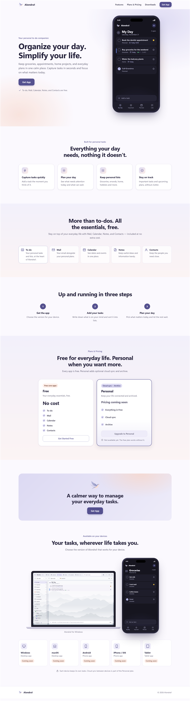

<p align="center"></p>

# Alondra1 landing page

[](https://github.com/alondrauno/alondra1-www/actions/workflows/ci.yml)

The one-page marketing site for **alondra1.com**: a personal to-do app first, with Mail, Calendar, Notes, and Contacts included free, and paid plans that add cloud sync, archive and shared spaces. It is a static site built by a small standard-library Python script and served by unprivileged nginx in its own container. One image contains a `dev` and a `prod` variant; [alondra1-infra](https://github.com/alondrauno/alondra1-infra) deploys it on its own landing server per environment (alondra1.dev, alondra1.com) behind Cloudflare.

| Mobile (375 px) | Desktop (1440 px) |
| --- | --- |
|  |  |

Tablet: [docs/screenshots/landing-768.png](docs/screenshots/landing-768.png).

## Local development

You need Python 3.11 or newer. There are no packages to install.

```sh
python build.py                                   # -> dist/dev and dist/prod
python -m unittest discover -s tests -t .         # content rules and built-page checks
python -m http.server 8000 --directory dist/prod  # http://localhost:8000
```

Edit `src/` (page, styles, script), `config/site.json` (plans, platforms, links), or `public/` (images, favicons), then rebuild.

### With Docker (production-like)

```sh
docker build -t alondra1-landing:local .
docker run --rm -p 127.0.0.1:8080:8080 alondra1-landing:local
curl http://127.0.0.1:8080/healthz                # ok
```

The image build runs the tests first, so a page that breaks a content rule never becomes an image.

## Layout

| Path | Contents |
| --- | --- |
| `config/site.json` | The single data source: plans `{id, name, priceLabel, periodLabel, description, features[], ctaLabel, ctaUrl, featured, enabled}`, platforms `{id, label, status, downloadUrl?, subtitle?}`, and links. |
| `src/index.html` | Page template with the copy, in the spec's section order. `{{NAME}}` placeholders are filled by `build.py`. |
| `src/styles.css`, `src/main.js`, `src/consent.js` | Design tokens and layout (including the cookie banner); mobile menu (focus, Escape, click outside), header state, footer year; cookie consent and Consent Mode v2 (only included in variants with a GTM container (prod)). Fingerprinted into `/assets/` at build time. |
| `src/404.html` | Not-found page. |
| `public/` | Logo sizes, favicon, Open Graph image, and the Windows To-do screenshot for the device showcase. Copied as-is. |
| `build.py` | Validates the config, renders the page, writes `robots.txt`, `sitemap.xml`, and `404.html`. |
| `tests/` | `unittest` suite: plan and platform rules, links, section order, images, consent banner and Consent Mode defaults, no other third-party requests. |
| `nginx/` | Server config template (variant chosen by `ALONDRA1_ENVIRONMENT`), port 8080, `/healthz`, security headers (strict CSP), dev `X-Robots-Tag`, caching, start-up check. |
| `Dockerfile`, `compose.yaml` | Python build stage (both variants) → `nginxinc/nginx-unprivileged:stable-alpine` (pinned by digest); the Compose file alondra1-infra deploys. |
| `docs/` | [Feature map](docs/FEATURE-MAP.md) (every page feature with its file and test), [launch checklist and verification results](docs/LAUNCH.md), screenshots. |

## Configuration

Everything is in `config/site.json` and reviewed in pull requests; nothing here is secret.

| Setting | Effect |
| --- | --- |
| `environments.<env>.siteUrl` | Canonical URL, Open Graph URLs, sitemap (`https://alondra1.dev`, `https://alondra1.com`). The dev variant must use a dev hostname; the prod variant may not name one. |
| `environments.<env>.links` | **Log in**, **Register** and **Create account** (the backend account page of that environment), and the footer links Privacy, Terms, Contact (empty = the site's own `/privacy/`, `/terms/`, `/contact/` pages; an `https://` URL overrides). |
| `config/legal.json` | Operator details for the Privacy, Terms and Contact pages (`src/legal/*.html`). Replace every `[PLACEHOLDER]`; until then the prod variant publishes neither the pages nor Google Analytics, and dev shows them as drafts. |
| `environments.<env>.noindex` | dev: `noindex` meta tag, `robots.txt` with `Disallow: /`, no sitemap, and `X-Robots-Tag` from nginx. |
| `environments.<env>.gtmId` | Google Tag Manager, prod only (`GTM-T6TDXTK3`), loaded only after consent. Never in a noindex variant. |
| `environments.<env>.webAppUrl`, `webApp.enabled` | **Open Web App** button, shown only once the Web app is verified (`enabled: true`). |
| `plans`, `plansNote` | The four plans and the platform note under them. |
| `platforms` | Platform cards, with the modules each one has (Mail and Contacts only on Windows). |

The container serves the variant named by `ALONDRA1_ENVIRONMENT` (`dev` or `prod`; it refuses to start otherwise). Links must be `https://`, `mailto:`, a `/path`, or an `#anchor`; the build fails otherwise. For a local experiment, the old variables (`SITE_URL`, `LOGIN_URL`, `REGISTER_URL`, `PRIVACY_URL`, `TERMS_URL`, `CONTACT_URL`, `GTM_ID`) still override values when you run `build.py`.

### Content rules (enforced by the build and the tests)

- The free plan lists To-do, Mail, Calendar, Notes, and Contacts. Cloud sync and Archive appear only in paid plans, and paid plans never list the core apps.
- Four plans: Free, Personal, Friends & Family, Enterprise. Paid plans stay disabled until their prices are approved and billing exists.
- Only Windows may list Mail and Contacts; the note under the plans says so.
- A plan CTA is a link only when `enabled` with a valid `ctaUrl`; otherwise it renders as a disabled button with a note. A paid `priceLabel` may not contain a number until the plan is enabled.
- A platform shows **Download** only when `status` is `available` with an `https` `downloadUrl`; `comingSoon` shows a non-clickable status. An unreleased platform may not carry a URL.
- The only third-party script is the Google Tag Manager container, and only in the prod variant. No other third-party scripts, styles, or fonts.

### Publishing a release or a price

- **Download:** set the platform to `"status": "available", "downloadUrl": "https://…"` (an official installer or store listing), run the tests, merge.
- **Price:** set the Personal plan's `priceLabel` and `periodLabel` to the owner-approved values, `ctaUrl` to the verified checkout or account page, and `"enabled": true`.

## Analytics and cookie consent

Production uses Google Tag Manager container `GTM-T6TDXTK3` behind a cookie banner, with Google Consent Mode v2 in its **basic** form: nothing from Google loads until the visitor accepts.

- `src/consent.js` loads first in `<head>` (with `data-gtm-id`). Before anything else it sets every consent signal to `denied`: `ad_storage`, `ad_user_data`, `ad_personalization`, `analytics_storage`, `functionality_storage`, and `personalization_storage` (`security_storage` stays granted). It also turns on `ads_data_redaction`.
- **Before consent:** no request to Google and no cookies. The banner shows on the first visit and again after 12 months.
- **Accept:** `gtag('consent','update',{analytics_storage:'granted'})`, then GTM is injected with the standard `gtm.js` start event. The advertising signals stay denied, because the banner only asks about analytics.
- **Decline:** nothing loads. Declining after accepting (footer → **Cookie settings**) sets consent back to denied, deletes `_ga*`/`_gid`/`_gat*`/`_gcl*` cookies, and reloads the page so the container stops.
- The choice is kept in `localStorage` (`alondra1-consent`), not in a cookie. **Accept** and **Decline** have the same style, so refusing is as easy as agreeing. The banner is a small non-modal card that doesn't block the page.
- Without a GTM container (dev variant, local builds) there is no banner, no Cookie settings link, and no Google code.
- The CSP allows Google's documented GTM and GA4 hosts (`nginx/snippets/security-headers.inc`). GTM *Custom HTML* tags, and tags that load scripts from other hosts, are blocked until you add those hosts there.
- There is no `<noscript>` fallback, so visitors without JavaScript are never tracked.

### Settings inside the GTM container (Google's web UI, not in this repository)

1. **Admin → Container settings → Enable consent overview.**
2. In the **GA4 configuration (Google tag)** and every GA4 event tag: **Advanced settings → Consent settings → Require additional consent for tag to fire → `analytics_storage`**. This is a second safety net; the page already withholds GTM until the visitor accepts.
3. Don't add advertising tags (Google Ads, Floodlight, remarketing). The banner doesn't ask for advertising consent, so `ad_storage`, `ad_user_data`, and `ad_personalization` stay denied.
4. In GA4: **Admin → Data collection → Granular location and device data collection** as you prefer, and keep **Google signals** off unless the privacy policy covers it.
5. Publish the container, then check with **Preview / Tag Assistant** on `https://alondra1.com/`. Before you click Accept, the consent state should be *denied* and no GA4 tag should fire. After Accept, the page view should fire with `analytics_storage: granted`.

## Deployment

This repository holds no deployment credentials. Every merge to `main` runs [`release`](.github/workflows/release.yml): the checks, then one image tagged with the commit (both variants), with SBOM and provenance, scanned, signed by digest, and handed to alondra1-infra, which verifies it and deploys **dev**. **prod** gets exactly that digest after approval in alondra1-infra (`promote.yml`). The deployed Compose file is [`compose.yaml`](compose.yaml) (read-only container, `127.0.0.1:8080`, the edge connector in front).

Roll back: alondra1-infra `scripts/rollback/rollback.py <env> www`, reviewed and (prod) approved like any release.

The landing no longer deploys through shared-landing (spec v1.1 §5.2); the cleanup there follows the cutover (alondra1-infra `docs/operations/shared-landing-migration.md`).

## CI

| Workflow | When | What |
| --- | --- | --- |
| [`ci`](.github/workflows/ci.yml) | push to `main`, pull requests | Tests, build of both variants, html-validate, offline link check, Docker build plus a read-only container smoke test of both variants (health, 404, headers, noindex in dev, caching, non-root, refuses a missing environment), gitleaks. |
| [`release`](.github/workflows/release.yml) | push to `main` | Runs `ci`, then builds, scans, signs and attests the image and asks alondra1-infra to record it for dev. |

All third-party actions are pinned to commit SHAs. Repository settings: the `dev` environment with variables `RELEASE_APP_ID`, `INFRA_REPOSITORY_OWNER` and secret `RELEASE_APP_PRIVATE_KEY`.

## Related repositories

[alondra1-infra](https://github.com/alondrauno/alondra1-infra) (hosting and releases) · [alondra1-windows](https://github.com/alondrauno/alondra1-windows) · [alondra1-backend](https://github.com/alondrauno/alondra1-backend) · [alondra1-android](https://github.com/alondrauno/alondra1-android) · [alondra1-iphone](https://github.com/alondrauno/alondra1-iphone) · [alondra1-mac](https://github.com/alondrauno/alondra1-mac)

## License

[MIT](LICENSE)
